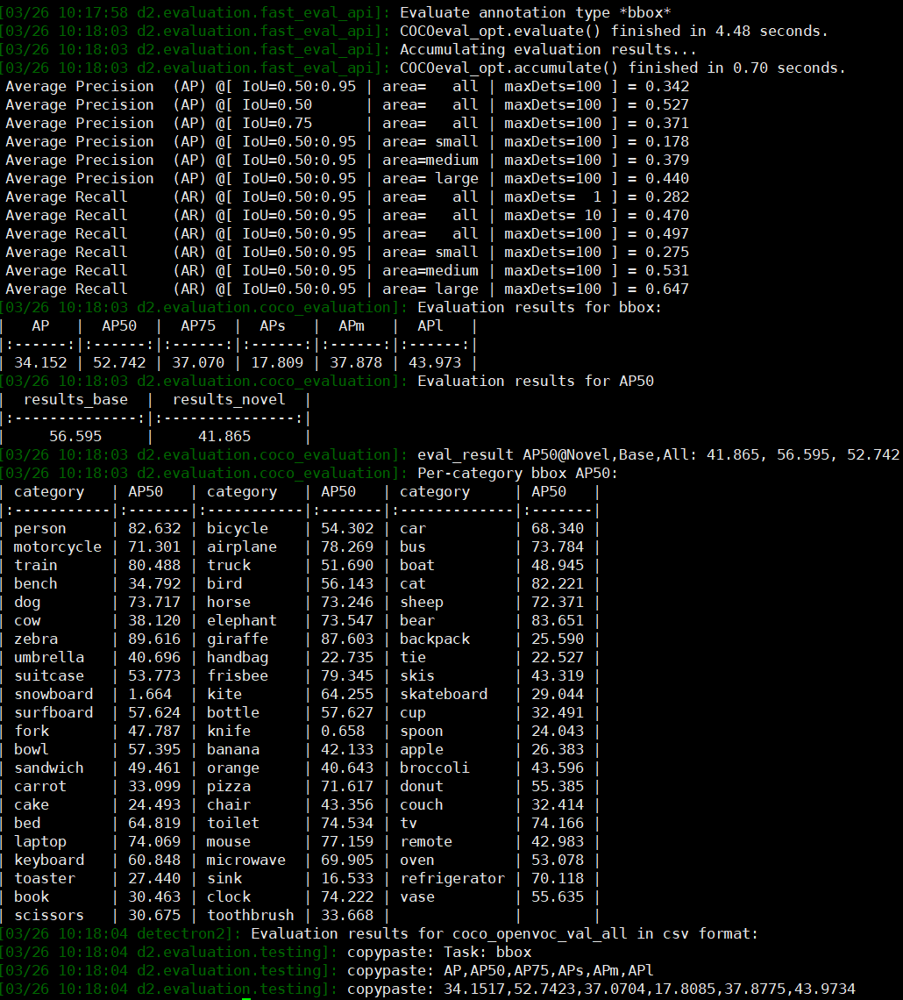

<h2 align="center">
✨Foreground-Generalized RPN and Language-Guided Visual Augmentation for Open-Vocabulary Object Detection
</h2>

This repository is the official implementation of [**Foreground-Generalized RPN and Language-Guided Visual Augmentation for Open-Vocabulary Object Detection**](https://dl.acm.org/doi/10.1145/3746027.3754501) accepted by [**ACM MM 2026**](https://2026.acmmm.org/).      
> Qiuyu Liang, Yongqiang Zhang*  

## 📦 Installation
Our project is developed on [MarvelOVD](https://github.com/wkfdb/MarvelOVD) and [Detectron2](https://github.com/facebookresearch/detectron2).

## 🏆 Trained FLDet Checkpoints

| OV-COCO  | Novel AP50 | Base AP50 | Overall AP50 | Weight |
|----------|-----------|-----------------|-----------------|-----------------|
| [config_RN50](configs/coco_ssod.yaml) | 41.8      | 56.6            |52.7             | [weight](https://drive.google.com/file/d/1oh3oS4oMMGymKG4WIUhmhnc7KTaserRD/view?usp=drive_link)| 
<p align="left">

<p>
    
## 🏃 Run

### Training on OV-COCO

```bash
python train_net.py --config configs/coco_ssod.yaml --num-gpus=4
```

## 📝 Citation

If you find this project useful, please consider citing our work.

```bibtex
@article{modet,
  title={Foreground-Generalized RPN and Language-Guided Visual Augmentation for Open-Vocabulary Object Detection},
  author={},
  journal={ACM MM},
  year={2026}
}
```

## 🙏 Acknowledgement

This project is built upon [MarvelOVD](https://github.com/wkfdb/MarvelOVD). We sincerely thank the authors for their excellent work.

